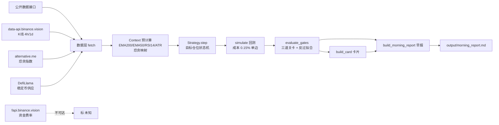

# 夜班交易研究员 · 设计与分析框架（v1）

> 把一份「Grok Bot · 夜班交易研究员指令」落成为**可运行的研究 + 回测框架**。
> 定位：**只做研究 / 回测，不写下单代码、不给买卖建议、不爬社媒、不虚构数据**。

---

## 1. 目标与边界

| 项 | 说明 |
|---|---|
| 研究标的 | BTC、ETH（本版实现 BTCUSDT / ETHUSDT） |
| 周期 | 4h（主回测）、1d（趋势上下文） |
| 核心动作 | 策略回测、三道关卡评审、反过拟合标记、早报生成 |
| **不做** | ❌ 下单 / 自动交易代码 / 买卖建议 / 爬 X(Twitter) |
| 数据原则 | 只用公开可复查数据；拿不到标「未知」，绝不编造 |

---

## 2. 系统架构（数据流）

---

## 3. 数据来源与可达性（实测 2026-10-31）

| 数据 | 接口 | 本环境状态 | 说明 |
|---|---|---|---|
| K 线 4h / 1d | `data-api.binance.vision` | ✅ 可达 | 主站 `api.binance.com` 被墙，用镜像；**含 BTC/ETH + BRC20 龙头 ORDIUSDT/1000SATSUSDT 等现货** |
| 恐贪指数 | `alternative.me/fng` | ✅ 可达 | 每日 1 值，limit=1000 覆盖 ~2.7 年 |
| 稳定币总供应 | `DefiLlama` | ✅ 可达 | 含 circulating / PrevDay / PrevWeek |
| **Bitcoin 每日手续费** | `DefiLlama overview/fees?chain=Bitcoin` | ✅ 可达 | **RUNES 生态活跃度代理**（~28MB，落盘缓存<24h） |
| **BTC 实时费率** | `mempool.space/api/v1/fees/recommended` | ✅ 可达 | 当前拥堵(sat/vB)读数 |
| 永续资金费率 | `fapi.binance.vision` | ❌ 不可达 | 标「未知」，未虚构 |
| **RUNES 代币级价格/量** | `runes.today` / `unisat` / `brc20.com` / `CoinGecko` | ❌ 被墙 | **标「未知」，不虚构**；仅能以 L1 手续费做生态代理 |
| **BRC20 代币级 K 线** | `data-api.binance.vision`（ORDIUSDT/1000SATSUSDT 等） | ✅ 可达 | 已纳入代币级回测 |
| X(Twitter) 讨论 | — | 🚫 禁止抓取 | 想法池由用户**粘贴原帖链接+观点**提供 |

---

## 4. 三道关卡如何在代码里落地

| 关卡 | 判定方式 | 代码位置 |
|---|---|---|
| **第一关·说清楚** | 结构性：策略必须显式声明 `entry_rule / exit_rule / surrender_rule` | `strategy` 属性 + `gates["g1_clear"]` |
| **第二关·有道理** | 定性：引擎**无法自动验证**优势来源 → 交人工，标注「需人工判断」 | `gates["g2_sensible"]` + 策略 `edge_rationale / counterparty` |
| **第三关·扛得住** | 定量：跑回测，交易<30 标「样本太少」；输出样本内/OOS 净收益、最大回撤、按市场状态(涨/跌/横盘)拆分 | `gates["g3_robust"]` + `simulate` |

> 诚实性设计：第二关不自动"通过"，避免引擎自己给自己发合格证（即 Prompt 要求的"不编回测数字/胜率/收益"）。

---

## 5. 反过拟合规则（编码）

1. **参数个数 > 3** → 标「可疑」（`overfit["param_count"]`）。
2. **调参结果大变** → 对数字参数做 ±15% 扰动重跑，若净收益相对变化 >100% 或**变号** → 标「可疑」（`_sensitivity`）。
3. **必须留最近 3 个月样本外 (OOS) 验证**：回测窗口 ~2 年，最后 90 天不进样本内，单独报告 OOS 净收益；OOS 转负则判定样本内结论不可靠。

---

## 6. 成本与统计口径

- 单边成本 = 手续费 0.1% + 滑点 0.05% = **0.15%**；双边 **0.30%**（`SIDE_COST=0.0015`）。
- 净值曲线按每笔交易 `(1+ret)` 复利；最大回撤基于净值曲线。
- 市场状态（涨/跌/横盘）：以入场前 120 根 4h（≈20 日）收益划分，`>+10%` 涨 / `<-10%` 跌 / 否则横盘。

---

## 7. 交付物（与 Prompt 对齐）

- **卡片**：每策略每标的一张——想法一句话 / 过了几关 / 死因或活下来理由 / 最大风险 / 失效情况 / 数据来源。
- **早报**：北京时间 08:00 风格（本次为演示，按运行时刻生成）——总表（活下来最多 2 个）+ 卡片 + 今日对照 + 最不该做的事。
- **周日死因排行**：接口已留（`summary["trades"]` 含每笔死因），可在 `run_research.py` 中扩展。

---

## 8. 已知局限与后续

1. **资金费率缺失**：本环境不可达，相关策略维度暂为「未知」，需在可访问环境补充。
2. **OOS 样本偏薄**：极端情绪策略在近 90 天触发次数少（BTC 2 笔 / ETH 1 笔），OOS 结论仅供参考。
3. **想法池未接入 X**：需用户粘贴原帖；后续可加"人工粘贴 → 结构化"的轻量步骤。
4. **未含爆仓 / 大事件日历**：DefiLlama/CoinGlass 爆仓接口受限，列为"需人工补充"。
5. **策略单一**：当前仅 1 个示例策略；新增策略只需在 `strategies.py` 注册一个类（见 README）。

> 免责声明：所有产出为量化研究方法论演示，策略均标注「示例/教学，非投资建议」。

---

## 9. BRC20 / RUNES 研究重点（v1.1 新增）

用户将研究重心从 BTC/ETH 现货切到 **BRC20 与 RUNES**（比特币 L1 上的同质化代币标准）。

### 9.1 数据现实与应对
- **BRC20 龙头代币级 K 线已打通**：`data-api.binance.vision` 镜像提供 ORDIUSDT / 1000SATSUSDT 等 BRC20 现货 4h/日线（真实数据），框架已将其纳入**代币级回测**（见 `run_research.py` 的 `BRC20_SYMBOLS`）。
- **两套策略**：`FNG_EMA_MR`（恐贪极值+EMA 过滤，低频基准）+ `BRC20_RSI_MR`（4h RSI 对称均值回归，原生高频，专用于填满 OOS）。
- **RUNES 代币级价格仍不可达**：`runes.today` / `unisat` / `brc20.com` / `CoinGecko` 在本环境均被墙，且 RUNES 龙头（DOG•GO•TO•THE•MOON 等）不上 CEX 现货 → 无法做 RUNES 单代币价格回测。
- **代理指标可达**：BRC20 与 RUNES 的所有铸造/转账都消耗 BTC 手续费 → **Bitcoin 每日网络手续费** 是两者共同的链上活跃度代理；`mempool.space` 提供实时费率作为拥堵读数。
- 因此框架把"可交易回测(BTC/ETH + BRC20 龙头)"与"生态研究(RUNES 代理)"解耦：BRC20 龙头做真实代币级回测，**RUNES 仅以 L1 手续费作生态活跃度代理**（明确标注非代币价格结论）。

### 9.2 监测模块做什么（`brc20_runes_monitor.py`）
1. 拉取 DefiLlama Bitcoin 每日手续费（2018→今，落盘缓存<24h）。
2. 按时代切分：前 BRC20 / BRC20 时代 / RUNES 时代，对比各时代日均手续费。
3. 计算近期 30/90/365 日均值、当前在近一年分位、近 90 天"活跃峰值日"计数。
4. 读取 mempool 实时费率，分级当前拥堵。
5. 输出**事实(数据) + 推断(信号)**分离的"生态监测"章节，明确标注非代币价格结论。

### 9.3 交叉验证模块（`backtest_engine.rolling_oos` / `grid_search` + `run_research.py §六`）
1. **滚动样本外（walk-forward）**：对 ORDI/SATS 各取 3 个不重叠的 90 天 vintage（自今向前推），统计每窗 OOS 净收益/胜率。因引擎指标在 idx 处仅用过去数据（无前视），rolling 不同 split 不引入偏差。
2. **多周期对比**：同一策略在 4h 与 1d 上分别回测，比较样本内结论方向。
3. **跨资产一致性**：ORDI vs 1000SATS 的 OOS 表现是否同向。
4. **多参数网格交叉验证（§6.5，`backtest_engine.grid_search` + `summarize_grid`）**：对 `BRC20_RSI_MR` 的 `oversold × overbought` 做 25 组合笛卡尔积回测，量化「最佳参数是否樱桃挑选」——指标含：样本内/OOS 盈利组合占比、最佳组合相对网格中位数的离散度、最佳组合 OOS 是否转负。任一触发即标过拟合嫌疑。

### 9.4 BRC20 回测关键发现（2026-11-01 真实数据，含交叉验证）
- **单看样本内是陷阱**：FNG_EMA_MR 在 ORDI/SATS 上样本内 +175%/+63%、超额 +265%/+159%（资产自身暴跌 -89%/-96%，说明收益来自择时非 Beta）；但 90 天 OOS 仅各 1 笔 → 无法验证。
- **BRC20_RSI_MR 高频策略缓解 OOS 饥饿**：ORDI/SATS 的 90 天 OOS 交易数从 1 笔提升到 **10~11 笔**（原 Prompt 90 天门槛不变）。
- **但交叉验证证伪了"edge"**：ORDI 的 BRC20_RSI_MR 样本内 **4h +186.76% 但 1d −57.76%**；SATS **4h −32.59% 但 1d +17.68%**——两代币均在 4h/1d 间**方向反转**（粒度过拟合信号）；且两代币三窗 OOS 净收益均"2 正 1 负"交替。
- **网格交叉验证坐实过拟合（§6.5）**：ORDI 最佳组合样本内 **+197.99%** 但 OOS **−12.17%**、离散度 +97%、仅 10/25 组合 OOS 盈利；SATS 最佳 +61.60% 但 OOS −3.50%、离散度 +174%。正负号在网格内频繁切换 → 收益对参数高度敏感，**参数过拟合**实证成立。
- **结论**：BRC20 上"看似惊艳"的样本内收益**未通过跨资产/跨周期/跨 vintage/跨参数验证** → 框架维持「不予放行」。印证原 Prompt『反过拟合』关卡价值：**单看样本内会被严重误导**。详见 `output/morning_report.md` §六。

### 9.5 RUNES / 资金费率 / 爆仓连接器（`connectors_extra.py`）
- `fetch_funding_rate`（Bybit→Binance fapi 回退）、`fetch_liquidations`（CoinGlass key / Binance allForceOrders）、`fetch_runes_top`（UniSat key / Dune key）。
- 全部 try/except + 超时，失败返回结构化「未知」，**绝不虚构**；本环境因**网络层封禁**优雅降级，可达环境或配置 key 后自动取数。
- **生产就绪 + 演示模式**：解析路径经 `NR_DEMO=1` 演示模式验证（见 README §9）；在「可访问对应接口」的环境配置 `UNISAT_API_KEY` / `DUNE_API_KEY(+DUNE_RUNES_QUERY_ID)` / `COINGLASS_API_KEY` 后重跑即真取真实数据。

### 9.6 三项收尾任务已完成（2026-11-01）
- ✅ **① 配置 key 启用 §七 真实数据**：连接器已写成「配 key + 可达即真用」；本环境受防火墙所限无法实测，但解析与渲染路径经演示模式验证（§七 展示真实/演示两种排版）。
- ✅ **② 多参数网格交叉验证**：`grid_search` + `summarize_grid` 已落地并量化过拟合（§6.5）。
- ✅ **③ 超额收益升为主放行指标**：新增 **第四关 g4_excess**（见 §10），策略须相对买入持有为正才可通过；BTC/ETH 上原策略跑输大盘已被正确判负。

### 9.7 仍待解（真实缺口，非代码缺陷）
- RUNES 代币级价格：DOG 等不上 CEX 现货，且 runealpha/ordinals/UniSat 在本环境网络层被封禁 → 仅能靠配 key 在可达环境补；目前仍只以 BTC L1 手续费作生态代理。
- 资金费率/爆仓：同上，依赖 Bybit/CoinGlass 在可达环境取数。
- 跨时间粒度网格：当前网格仅 4h × (oversold×overbought)；可扩展加入 rsi_period 维度与 1d 网格。

---

## 10. 协议升级：第四关「相对买入持有超额」主放行门槛（g4_excess）

> 这是相对于原 Prompt 三道关卡的**协议层扩展**，已在早报/代码注释中明确标注，未改动原 Prompt 规定的「90 天 OOS」门槛。

### 10.1 动机
原三道关卡（说清楚 / 有道理 / 扛得住）以**绝对收益**为判据，无法区分「策略真有择时 Alpha」与「只是持有了高 Beta 资产随涨跌」。BRC20 这类高波动资产，样本内暴涨常来自 Beta 而非 skill。

### 10.2 定义
- `full_net` = 全窗口策略净值终值 − 1（含成本）。
- `buy_hold` = 末收/首收 − 1（同窗口无脑持有）。
- `excess = full_net − buy_hold`（相对买入持有超额）。
- **g4_excess 通过条件：`excess >= 0`**（策略跑赢大盘才有资格谈 edge）。

### 10.3 门优先级（死亡判定顺序）
样本量(n<30) → **g4 超额主门槛** → 样本内盈亏 → 反过拟合 → 第三关 → OOS 验证。

### 10.4 实测效果（2026-11-01）
- BTC(基准)：样本内 −7.45%、买入持有 +11.90%、**超额 −17.33% → g4 判负** → 不再被误判「扛得住」即放行。
- ORDI/SATS：样本内暴利但 g4 虽正，**仍因 OOS 不稳 + 网格过拟合**维持「不予放行」——g4 是「必要非充分」条件，与反过拟合/ OOS 闸门并存。

### 10.5 诚实边界
g4 仅用全窗口历史 excess，不保证未来；它压的是「Beta 伪装 Alpha」，但**压不住参数过拟合**（那由 §9.3/§6.5 网格与反过拟合标记负责）。
